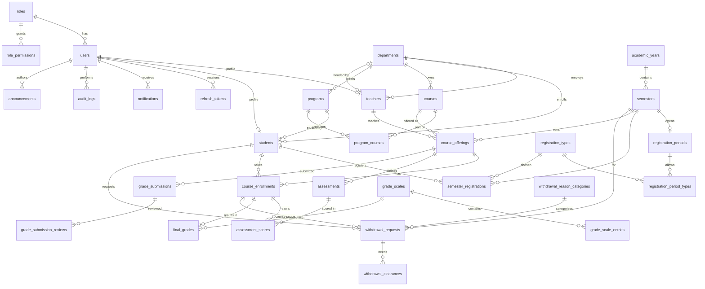

# Database Design — University Grading and Registration System

This is the relational schema for the backend that will replace the in-browser mock store. The client keeps that store in `client/store/` (seeded from `client/data/*.json`) and in a few page-local mock arrays.

It was built from a review of every page in `client/features/`, the store functions in `client/store/`, the grading logic in `client/lib/grading.js`, and the seed data. Where a page used hard-coded data that the store doesn't cover, this design adds the entities that page needs:

- semester registration
- withdrawal requests
- the department-head approval stage
- programs

The matching endpoints are in [API.md](API.md).

---

## 1. Conventions

| Topic | Decision |
|---|---|
| Target DBMS | PostgreSQL 15+. Types map directly to MySQL 8: `TIMESTAMPTZ` becomes `DATETIME`, `JSONB` becomes `JSON`, `BOOLEAN` becomes `TINYINT(1)` |
| Primary keys | `VARCHAR(32)` string IDs with a table prefix (`usr_…`, `stu_…`, `off_…`), the same format the client already uses in URLs and seed data. Lookup tables use a short code as the key (`admin`, `cafe`, `library`) |
| Naming | `snake_case` tables (plural) and columns. The API returns `camelCase` |
| Timestamps | `created_at` and `updated_at` are `TIMESTAMPTZ NOT NULL DEFAULT now()`. Pure dates (due dates, semester dates) are `DATE` |
| Enums | Stored as lower-case `VARCHAR` with a `CHECK` constraint (values in §4). Values that admins may extend (registration types, withdrawal reasons) are lookup tables |
| Money and score values | `NUMERIC(6,2)` for marks and scores; `NUMERIC(4,2)` for grade points and GPA |
| Deletes | Hard deletes only where the UI allows them and no history depends on the row. Otherwise `status` columns (archived, inactive). FKs default to `ON DELETE RESTRICT` |
| Derived values | GPA, CGPA, credits, standing, counts and running percentages are **computed, not stored** (§6) |

---

## 2. Entity overview

| # | Table | Purpose | Status vs. current client |
|---|---|---|---|
| 1 | `roles` | The 4 actor roles | exists (`roles.json`) |
| 2 | `role_permissions` | Permission codes per role | exists as an array in `roles.json` |
| 3 | `users` | Login accounts for every role | exists |
| 4 | `refresh_tokens` | Server-side sessions (JWT refresh) | **new** (the client stores the user id in localStorage) |
| 5 | `departments` | Academic departments | exists |
| 6 | `programs` | Degree programmes (e.g. "BSc Computer Science") | **new** (today free text on the student) |
| 7 | `program_courses` | Curriculum: courses required by a programme | **new** (Progress page approximates it) |
| 8 | `teachers` | Teacher / dept-head profile linked to a user | exists |
| 9 | `students` | Student profile linked to a user | exists, plus `program_type`, `program_id`, `year_of_study` |
| 10 | `courses` | Course catalogue | exists |
| 11 | `academic_years` | e.g. 2026/2027 | exists |
| 12 | `semesters` | First / Second / Summer semester of a year | exists, plus `withdrawal_deadline` |
| 13 | `registration_types` | Café, Non-Café, Extension, Weekend | **new** |
| 14 | `registration_periods` | Registration window per semester | **new** (page-local mock today) |
| 15 | `registration_period_types` | Types allowed in a period (M:N) | **new** |
| 16 | `semester_registrations` | A student's registration for a semester | **new** (page-local mock today) |
| 17 | `course_offerings` | A course taught in a semester by a teacher (section) | exists |
| 18 | `course_enrollments` | Student enrolled in an offering | exists |
| 19 | `assessments` | Quiz, assignment, midterm, final… of an offering | exists |
| 20 | `assessment_scores` | Mark of one student on one assessment | exists |
| 21 | `grade_scales` | Versioned grading scale header | exists |
| 22 | `grade_scale_entries` | Letter ranges and grade points | exists as a nested array |
| 23 | `final_grades` | Final course result per enrollment | exists |
| 24 | `grade_submissions` | Teacher submits an offering's grades | exists (`gradeApprovalRequests`) |
| 25 | `grade_submission_reviews` | Dept-head / registrar decisions on a submission | **new** (one reviewer field today) |
| 26 | `withdrawal_reason_categories` | Lookup for withdrawal reasons | **new** |
| 27 | `withdrawal_requests` | Course, semester or university withdrawal | **new** (localStorage today) |
| 28 | `withdrawal_clearances` | Department / library / housing / registrar sign-off | **new** |
| 29 | `notifications` | Per-user inbox | exists |
| 30 | `announcements` | Broadcast messages | exists |
| 31 | `audit_logs` | Who did what, with before/after values | exists |
| 32 | `university_settings` | University info printed on transcripts | exists (`settings.university`) |
| 33 | `academic_policies` | Pass mark, GPA rules, approval workflow | exists (`settings.policy`) |
| 34 | `policy_excluded_courses` | Courses excluded from GPA | exists as an array |
| 35 | `department_assessment_templates` | Default assessment structure per department | **new**, optional (dept approvals page shows a fixed one) |

---

## 3. Entity–relationship diagram



---

## 4. Enumerations

Every value below is stored lower-case. The UI labels are in quotes.

| Enum | Values | Used on |
|---|---|---|
| `role` | `admin` "Administrator", `dept_head` "Department Head", `teacher` "Teacher", `student` "Student" | `users.role_id` |
| `user_status` | `active`, `inactive` | `users.status` |
| `student_academic_status` | `active`, `suspended`, `withdrawn`, `graduated` | `students.academic_status` |
| `program_type` | `regular`, `extension`, `weekend` | `students.program_type`. The UI spells it both "Extension" and "Extensions"; normalise to `extension` |
| `course_status` | `active`, `archived` | `courses.status` |
| `semester_term` | `first` "First Semester", `second` "Second Semester", `summer` "Summer Semester" | `semesters.term`. Seed `Fall`/`Spring`/`Summer` map to these |
| `semester_status` | `upcoming`, `active`, `closed` | `semesters.status` |
| `registration_period_status` | `scheduled`, `open`, `closed` | `registration_periods.status`. "Not Configured" in the UI means no row exists |
| `semester_registration_status` | `pending`, `registered`, `rejected`, `cancelled` | `semester_registrations.status`. "Not Registered" is derived (no row) |
| `grade_status` (offering) | `not_started`, `draft`, `submitted` "Pending approval", `approved` "Approved – awaiting publication", `rejected` "Returned", `published` | `course_offerings.grade_status` |
| `enrollment_status` | `pending`, `enrolled`, `completed`, `withdrawn` | `course_enrollments.status` |
| `assessment_type` | `assignment`, `quiz`, `midterm` "Midterm Exam", `final` "Final Exam", `practical` "Practical Exam", `project` | `assessments.type` |
| `final_grade_status` | `draft`, `submitted`, `approved`, `published` | `final_grades.status` |
| `special_grade` | `W` (Withdrawn), `I` (Incomplete), or NULL | `final_grades.special_grade` |
| `grade_submission_status` | `pending` (awaiting dept head), `approved` (awaiting registrar publication), `published`, `rejected` | `grade_submissions.status` |
| `review_stage` | `department`, `registrar` | `grade_submission_reviews.stage` |
| `review_decision` | `approved`, `rejected`, `published` | `grade_submission_reviews.decision` |
| `withdrawal_scope` | `course` (one enrollment), `semester` "Semester Withdrawal", `university` "University Withdrawal" | `withdrawal_requests.scope` |
| `withdrawal_status` | `pending`, `approved`, `rejected`, `cancelled` | `withdrawal_requests.status` |
| `clearance_office` | `department`, `library`, `housing` "Housing / Dorm", `registrar` | `withdrawal_clearances.office` |
| `clearance_status` | `pending`, `approved`, `rejected` | `withdrawal_clearances.status` |
| `notification_type` | `system`, `announcement`, `assignment`, `enrollment`, `marks_released`, `grade_published`, `grade_approved`, `grade_rejected`, `grade_attention`, `approval_required`, `registration`, `withdrawal` | `notifications.type` |
| `announcement_audience` | `all`, `student`, `teacher`, `dept_head` | `announcements.audience` |
| `repeat_policy` | `latest`, `highest`, `all` | `academic_policies.repeat_policy` |
| `incomplete_policy` / `withdrawal_policy` | `exclude`, `as_fail` | `academic_policies` |

---

## 5. Entities and attributes

**Legend:**
- **PK**: primary key.
- **FK**: foreign key.
- **UQ**: unique.
- **NN**: not null.
- **Null** means the column may be empty.

### 5.1 Identity and access

#### `roles`
| Attribute | Type | Constraints | Description |
|---|---|---|---|
| id | VARCHAR(20) | PK | `admin`, `dept_head`, `teacher`, `student` |
| name | VARCHAR(80) | NN | Display name, e.g. "System Administrator" |
| description | TEXT | Null | |

#### `role_permissions`
| Attribute | Type | Constraints | Description |
|---|---|---|---|
| role_id | VARCHAR(20) | PK, FK → roles | |
| permission | VARCHAR(60) | PK | e.g. `users.manage`, `grades.approve_department`, `grades.publish`, `grades.enter`, `transcript.view_own` |

#### `users`
| Attribute | Type | Constraints | Description |
|---|---|---|---|
| id | VARCHAR(32) | PK | `usr_…` |
| role_id | VARCHAR(20) | NN, FK → roles | |
| username | VARCHAR(32) | NN, UQ (case-insensitive) | `^[a-z0-9._-]{3,32}$` |
| first_name | VARCHAR(80) | NN | |
| last_name | VARCHAR(80) | NN | |
| email | VARCHAR(160) | NN, UQ (case-insensitive) | Suggested as `first.last@university.edu` |
| phone | VARCHAR(30) | Null | |
| password_hash | VARCHAR(255) | NN | bcrypt/argon2 hash, with the salt embedded. Replaces the client's `passwordSalt` + SHA-256 |
| must_change_password | BOOLEAN | NN, default true | Set on create and on admin password reset |
| status | VARCHAR(10) | NN, CHECK user_status, default `active` | |
| deactivation_reason | TEXT | Null | Required when status → inactive. Today it is kept only in the audit log |
| last_login_at | TIMESTAMPTZ | Null | |
| created_at / updated_at | TIMESTAMPTZ | NN | |

#### `refresh_tokens`
| Attribute | Type | Constraints | Description |
|---|---|---|---|
| id | VARCHAR(32) | PK | |
| user_id | VARCHAR(32) | NN, FK → users ON DELETE CASCADE | |
| token_hash | VARCHAR(255) | NN, UQ | Only the hash is stored |
| user_agent | VARCHAR(255) | Null | |
| ip_address | VARCHAR(45) | Null | |
| expires_at | TIMESTAMPTZ | NN | |
| revoked_at | TIMESTAMPTZ | Null | Set on logout or password change |
| created_at | TIMESTAMPTZ | NN | |

### 5.2 Organisation and people

#### `departments`
| Attribute | Type | Constraints | Description |
|---|---|---|---|
| id | VARCHAR(32) | PK | `dep_cs` |
| code | VARCHAR(6) | NN, UQ | `^[A-Z0-9]{2,6}$`, e.g. `CS`. Also accepted as the dept-head login ID |
| name | VARCHAR(120) | NN, UQ | |
| description | TEXT | Null | |
| head_teacher_id | VARCHAR(32) | Null, UQ, FK → teachers ON DELETE SET NULL | The department head. The user behind it must have role `dept_head` |
| created_at / updated_at | TIMESTAMPTZ | NN | |

> The client's free-text `headName` is dropped. The head is always a teacher record.

#### `programs` (new)
| Attribute | Type | Constraints | Description |
|---|---|---|---|
| id | VARCHAR(32) | PK | `prg_…` |
| department_id | VARCHAR(32) | NN, FK → departments | |
| code | VARCHAR(20) | NN, UQ | e.g. `BSC-CS` |
| name | VARCHAR(160) | NN | "BSc Computer Science" |
| duration_years | SMALLINT | NN, CHECK 1–7, default 4 | Upper bound for year of study |
| required_credits | SMALLINT | NN, CHECK > 0 | Shown as "credits earned of required" on the Progress page |
| status | VARCHAR(10) | NN, CHECK (`active`,`archived`) | |
| created_at / updated_at | TIMESTAMPTZ | NN | |

#### `program_courses` (new)
| Attribute | Type | Constraints | Description |
|---|---|---|---|
| program_id | VARCHAR(32) | PK, FK → programs ON DELETE CASCADE | |
| course_id | VARCHAR(32) | PK, FK → courses | |
| year_of_study | SMALLINT | Null, CHECK 1–7 | Recommended year |
| term | VARCHAR(10) | Null, CHECK semester_term | Recommended semester |
| is_required | BOOLEAN | NN, default true | false means elective |

#### `teachers`
| Attribute | Type | Constraints | Description |
|---|---|---|---|
| id | VARCHAR(32) | PK | `tch_…` |
| user_id | VARCHAR(32) | NN, UQ, FK → users | Role is `teacher` or `dept_head` |
| employee_number | VARCHAR(30) | NN, UQ | "Teacher ID", e.g. `EMP-CS-01`. Login credential |
| department_id | VARCHAR(32) | NN, FK → departments | |
| title | VARCHAR(20) | NN, default `Dr.` | Prefix in display name ("Dr. Jane Doe") |
| specialization | VARCHAR(120) | Null | |
| office_room | VARCHAR(30) | Null | |
| hire_date | DATE | NN | |
| created_at / updated_at | TIMESTAMPTZ | NN | |

#### `students`
| Attribute | Type | Constraints | Description |
|---|---|---|---|
| id | VARCHAR(32) | PK | `stu_…` |
| user_id | VARCHAR(32) | NN, UQ, FK → users | |
| student_number | VARCHAR(30) | NN, UQ | "Student ID", e.g. `UGR/24/0001`. Login credential |
| department_id | VARCHAR(32) | NN, FK → departments | |
| program_id | VARCHAR(32) | NN, FK → programs | Replaces free-text `program` |
| program_type | VARCHAR(10) | NN, CHECK program_type, default `regular` | **New column.** Today it is guessed from the last digit of the student number |
| admission_year | SMALLINT | NN, CHECK 2000–2100 | |
| year_of_study | SMALLINT | NN, CHECK 1 – programs.duration_years | **New column.** Today it is derived as current year − admission year + 1, which breaks for repeaters and withdrawals. Promoted by an admin or a yearly job |
| date_of_birth | DATE | Null | |
| academic_status | VARCHAR(12) | NN, CHECK student_academic_status, default `active` | `suspended` when the user is deactivated; `withdrawn` after an approved university withdrawal |
| created_at / updated_at | TIMESTAMPTZ | NN | |

### 5.3 Catalogue and calendar

#### `courses`
| Attribute | Type | Constraints | Description |
|---|---|---|---|
| id | VARCHAR(32) | PK | `crs_cs101` |
| code | VARCHAR(10) | NN, UQ | `^[A-Z]{2,6}\d{3}[A-Z]?$`, e.g. `CS101` |
| title | VARCHAR(160) | NN | "Course name" in the UI |
| department_id | VARCHAR(32) | NN, FK → departments | |
| credit_hours | SMALLINT | NN, CHECK 1–6 | Cannot change once grades are published for any offering |
| level | SMALLINT | NN, CHECK 100–900, default 100 | Derived from the code's digits in the UI |
| description | TEXT | Null | |
| status | VARCHAR(10) | NN, CHECK course_status, default `active` | Archived courses cannot get new offerings |
| created_at / updated_at | TIMESTAMPTZ | NN | |

#### `academic_years`
| Attribute | Type | Constraints | Description |
|---|---|---|---|
| id | VARCHAR(32) | PK | `ay_2026` |
| name | VARCHAR(9) | NN, UQ | `^\d{4}/\d{4}$`, e.g. `2026/2027` |
| start_date | DATE | NN | |
| end_date | DATE | NN, CHECK end_date > start_date | |
| is_current | BOOLEAN | NN, default false | Partial unique index: at most one true |
| created_at | TIMESTAMPTZ | NN | |

#### `semesters`
| Attribute | Type | Constraints | Description |
|---|---|---|---|
| id | VARCHAR(32) | PK | `sem_2026_fall` |
| academic_year_id | VARCHAR(32) | NN, FK → academic_years | |
| term | VARCHAR(10) | NN, CHECK semester_term | UQ (academic_year_id, term) |
| name | VARCHAR(60) | NN | "2026 First Semester" |
| sort_order | SMALLINT | NN, UQ | Chronological order (the client's `order`). Recomputed when a semester is inserted |
| start_date | DATE | NN | Must fall within the academic year |
| end_date | DATE | NN, CHECK > start_date | |
| grade_submission_deadline | DATE | NN, CHECK ≥ end_date | Used to flag offerings as **overdue** |
| withdrawal_deadline | DATE | Null | **New column.** Last day students may request withdrawal |
| is_current | BOOLEAN | NN, default false | Partial unique index: at most one true |
| status | VARCHAR(10) | NN, CHECK semester_status | Setting the current semester closes earlier ones and marks later ones upcoming |
| created_at | TIMESTAMPTZ | NN | |

### 5.4 Semester registration (new)

This models the Readme flow: each semester the admin opens a period, and every student must register again even if they registered last semester.

#### `registration_types`
| Attribute | Type | Constraints | Description |
|---|---|---|---|
| id | VARCHAR(20) | PK | `cafe`, `non_cafe`, `extension`, `weekend` |
| label | VARCHAR(60) | NN | "Regular (Café)", "Non-Regular (Non-Café)", "Extension", "Weekend" |
| description | TEXT | Null | |
| is_active | BOOLEAN | NN, default true | |

#### `registration_periods`
| Attribute | Type | Constraints | Description |
|---|---|---|---|
| id | VARCHAR(32) | PK | `per_…` |
| semester_id | VARCHAR(32) | NN, **UQ**, FK → semesters | One period per semester. The academic year comes through the semester |
| start_date | DATE | NN | "Opening date" |
| deadline | DATE | NN, CHECK deadline ≥ start_date | |
| status | VARCHAR(10) | NN, CHECK registration_period_status, default `scheduled` | Registration is accepted only when `open` **and** today is within [start_date, deadline] |
| created_by | VARCHAR(32) | NN, FK → users | |
| created_at / updated_at | TIMESTAMPTZ | NN | |

#### `registration_period_types`
| Attribute | Type | Constraints | Description |
|---|---|---|---|
| period_id | VARCHAR(32) | PK, FK → registration_periods ON DELETE CASCADE | |
| registration_type_id | VARCHAR(20) | PK, FK → registration_types | At least one row per period |

#### `semester_registrations`
| Attribute | Type | Constraints | Description |
|---|---|---|---|
| id | VARCHAR(32) | PK | `reg_…` |
| student_id | VARCHAR(32) | NN, FK → students | |
| semester_id | VARCHAR(32) | NN, FK → semesters | **UQ (student_id, semester_id)**: one registration per semester |
| period_id | VARCHAR(32) | NN, FK → registration_periods | The period it was submitted in |
| registration_type_id | VARCHAR(20) | NN, FK → registration_types | Must be allowed by the period |
| status | VARCHAR(10) | NN, CHECK semester_registration_status, default `pending` | Admin approval moves it to `registered` |
| submitted_at | TIMESTAMPTZ | NN | "Registration date" |
| reviewed_by | VARCHAR(32) | Null, FK → users | |
| reviewed_at | TIMESTAMPTZ | Null | |
| remarks | TEXT | Null | Required when rejected |
| created_at / updated_at | TIMESTAMPTZ | NN | |

### 5.5 Teaching and enrolment

#### `course_offerings`
| Attribute | Type | Constraints | Description |
|---|---|---|---|
| id | VARCHAR(32) | PK | `off_…` |
| course_id | VARCHAR(32) | NN, FK → courses | Course must be `active` |
| semester_id | VARCHAR(32) | NN, FK → semesters | Semester must not be `closed` at creation |
| teacher_id | VARCHAR(32) | NN, FK → teachers | Cannot change once grade_status is `submitted`, `approved` or `published` |
| section | VARCHAR(5) | NN | Upper-case. **UQ (course_id, semester_id, section)** |
| capacity | SMALLINT | NN, CHECK 1–500 | Cannot be set below the current non-withdrawn enrollment count |
| room | VARCHAR(30) | Null | |
| schedule | VARCHAR(80) | Null | "Tue/Thu 10:30–12:00" |
| grade_status | VARCHAR(12) | NN, CHECK grade_status, default `not_started` | Workflow state (§7.2) |
| created_at / updated_at | TIMESTAMPTZ | NN | |

#### `course_enrollments`
| Attribute | Type | Constraints | Description |
|---|---|---|---|
| id | VARCHAR(32) | PK | `enr_…` |
| offering_id | VARCHAR(32) | NN, FK → course_offerings | |
| student_id | VARCHAR(32) | NN, FK → students | **UQ (offering_id, student_id)** |
| status | VARCHAR(10) | NN, CHECK enrollment_status, default `enrolled` | |
| is_repeat | BOOLEAN | NN, default false | True if the student took the same course before |
| enrolled_at | TIMESTAMPTZ | NN | |
| withdrawn_at | TIMESTAMPTZ | Null | Set when status → withdrawn |
| created_at / updated_at | TIMESTAMPTZ | NN | |

> An enrollment can be deleted only if it has no scores and no final grade ("created in error"). Otherwise it is withdrawn.

### 5.6 Assessment and grading

#### `assessments`
| Attribute | Type | Constraints | Description |
|---|---|---|---|
| id | VARCHAR(32) | PK | `asm_…` |
| offering_id | VARCHAR(32) | NN, FK → course_offerings ON DELETE CASCADE | |
| name | VARCHAR(80) | NN | **UQ (offering_id, lower(name))**. Also used as the CSV import column header |
| type | VARCHAR(12) | NN, CHECK assessment_type | |
| max_marks | NUMERIC(6,2) | NN, CHECK 1–1000 | Cannot go below the highest mark already entered |
| weight | NUMERIC(5,2) | NN, CHECK 0.5–100 | Σ weight per offering ≤ 100; must be exactly 100 to submit |
| due_date | DATE | NN | |
| description | TEXT | Null | |
| is_released | BOOLEAN | NN, default false | Students see marks only when released (or after publication) |
| released_at | TIMESTAMPTZ | Null | |
| created_at / updated_at | TIMESTAMPTZ | NN | |

#### `assessment_scores`
| Attribute | Type | Constraints | Description |
|---|---|---|---|
| id | VARCHAR(32) | PK | `scr_…` |
| assessment_id | VARCHAR(32) | NN, FK → assessments | **UQ (assessment_id, enrollment_id)** |
| enrollment_id | VARCHAR(32) | NN, FK → course_enrollments | Enrollment must belong to the same offering and must not be withdrawn |
| marks | NUMERIC(6,2) | NN, CHECK ≥ 0 | ≤ assessment.max_marks (enforced in the service). A missing mark has **no row**; clearing a mark deletes the row |
| remarks | TEXT | Null | |
| updated_by | VARCHAR(32) | NN, FK → users | |
| created_at / updated_at | TIMESTAMPTZ | NN | |

> Change history (before → after, reason) is kept in `audit_logs` with `entity_type = 'assessment_score'` and `offering_id` set. The "Grade change history" panel reads from there.

#### `grade_scales`
| Attribute | Type | Constraints | Description |
|---|---|---|---|
| id | VARCHAR(32) | PK | `gsc_…` |
| name | VARCHAR(80) | NN | "Standard Undergraduate Scale" |
| is_active | BOOLEAN | NN | Partial unique: one active scale |
| effective_from | TIMESTAMPTZ | NN | Saving a changed scale creates a **new version** instead of editing in place, so published grades keep the scale they were computed with |
| created_by | VARCHAR(32) | Null, FK → users | |
| created_at / updated_at | TIMESTAMPTZ | NN | |

#### `grade_scale_entries`
| Attribute | Type | Constraints | Description |
|---|---|---|---|
| id | VARCHAR(32) | PK | |
| scale_id | VARCHAR(32) | NN, FK → grade_scales ON DELETE CASCADE | |
| letter | VARCHAR(3) | NN | **UQ (scale_id, letter)** |
| min_score | NUMERIC(5,2) | NN, CHECK 0–100 | |
| max_score | NUMERIC(5,2) | NN, CHECK 0–100, ≥ min_score | |
| grade_points | NUMERIC(3,2) | NN, CHECK 0–5 | |

> Validation (service layer): the lowest entry starts at 0, the highest ends at 100, and there are no overlaps or gaps greater than 0.01.
> Default scale: A 90–100 = 4.0, A- 85 = 3.75, B+ 80 = 3.5, B 75 = 3.0, B- 70 = 2.75, C+ 65 = 2.5, C 60 = 2.0, D 50 = 1.0, F 0 = 0.0.

#### `final_grades`
| Attribute | Type | Constraints | Description |
|---|---|---|---|
| id | VARCHAR(32) | PK | `fgr_…` |
| enrollment_id | VARCHAR(32) | NN, **UQ**, FK → course_enrollments | |
| grade_scale_id | VARCHAR(32) | NN, FK → grade_scales | Scale version used |
| total_score | NUMERIC(5,2) | Null, CHECK 0–100 | NULL for W/I |
| letter | VARCHAR(3) | NN | Scale letter, `W` or `I` |
| grade_points | NUMERIC(3,2) | Null | NULL for W/I |
| special_grade | CHAR(1) | Null, CHECK (`W`,`I`) | |
| status | VARCHAR(10) | NN, CHECK final_grade_status | Mirrors the offering workflow |
| is_stale | BOOLEAN | NN, default false | Set when marks change after a draft final grade was computed |
| computed_at | TIMESTAMPTZ | NN | |
| submitted_at | TIMESTAMPTZ | Null | |
| approved_at | TIMESTAMPTZ | Null | |
| published_at | TIMESTAMPTZ | Null | Only published grades count in transcripts and GPA |
| updated_at | TIMESTAMPTZ | NN | |

#### `grade_submissions` (replaces `gradeApprovalRequests`)
| Attribute | Type | Constraints | Description |
|---|---|---|---|
| id | VARCHAR(32) | PK | `gar_…` |
| offering_id | VARCHAR(32) | NN, FK → course_offerings | Many per offering: resubmissions after a rejection keep the history |
| submitted_by | VARCHAR(32) | NN, FK → users | |
| submitted_at | TIMESTAMPTZ | NN | |
| note | TEXT | Null | Teacher's note ("Your note") |
| student_count | SMALLINT | NN | |
| status | VARCHAR(10) | NN, CHECK grade_submission_status, default `pending` | At most one `pending`/`approved` submission per offering (partial unique index) |

#### `grade_submission_reviews` (new)
| Attribute | Type | Constraints | Description |
|---|---|---|---|
| id | VARCHAR(32) | PK | |
| submission_id | VARCHAR(32) | NN, FK → grade_submissions ON DELETE CASCADE | |
| stage | VARCHAR(12) | NN, CHECK review_stage | `department` = dept head; `registrar` = admin |
| decision | VARCHAR(10) | NN, CHECK review_decision | |
| reviewer_id | VARCHAR(32) | NN, FK → users | |
| comment | TEXT | Null | **Required when decision = rejected** |
| reviewed_at | TIMESTAMPTZ | NN | |

#### `department_assessment_templates` (new, optional)
| Attribute | Type | Constraints | Description |
|---|---|---|---|
| id | VARCHAR(32) | PK | |
| department_id | VARCHAR(32) | NN, FK → departments | |
| name | VARCHAR(80) | NN | e.g. "Quiz", "Midterm" |
| type | VARCHAR(12) | NN, CHECK assessment_type | |
| max_marks | NUMERIC(6,2) | NN | |
| weight | NUMERIC(5,2) | NN | Weights per department sum to 100 |
| sort_order | SMALLINT | NN | |

### 5.7 Withdrawals (new)

A single table covers the three kinds of withdrawal the UI shows:

- **course**: the "Request Withdrawal" button on the student course page.
- **semester** and **university**: the Withdrawal Request page.

#### `withdrawal_reason_categories`
| Attribute | Type | Constraints | Description |
|---|---|---|---|
| id | VARCHAR(30) | PK | `medical`, `financial`, `personal_family`, `relocation_transfer`, `employment`, `academic`, `personal_emergency`, `other` |
| label | VARCHAR(60) | NN | "Medical / Health", "Financial Hardship", … |
| is_active | BOOLEAN | NN, default true | |

#### `withdrawal_requests`
| Attribute | Type | Constraints | Description |
|---|---|---|---|
| id | VARCHAR(32) | PK | |
| reference_no | VARCHAR(12) | NN, UQ | Human-readable `WR-001`, generated from a sequence (not a row count) |
| student_id | VARCHAR(32) | NN, FK → students | |
| scope | VARCHAR(10) | NN, CHECK withdrawal_scope | |
| semester_id | VARCHAR(32) | Null, FK → semesters | Required for `course` and `semester`. For `university`, it is the semester from which the withdrawal takes effect |
| enrollment_id | VARCHAR(32) | Null, FK → course_enrollments | Required if and only if scope = `course` |
| reason_category_id | VARCHAR(30) | NN, FK → withdrawal_reason_categories | |
| reason | TEXT | NN | Free-text explanation |
| status | VARCHAR(10) | NN, CHECK withdrawal_status, default `pending` | Only `pending` can move to `approved`, `rejected` or `cancelled` |
| submitted_at | TIMESTAMPTZ | NN | Replaces the display-string `requestDate` |
| decided_by | VARCHAR(32) | Null, FK → users | |
| decided_at | TIMESTAMPTZ | Null | |
| admin_notes | TEXT | Null | Decision remarks shown to the student |
| created_at / updated_at | TIMESTAMPTZ | NN | |

> Student name, department and program type are **joined from `students`**, not copied as the localStorage mock does.
> Partial unique index: one `pending` request per (student_id, scope, semester_id, enrollment_id).

#### `withdrawal_clearances`
| Attribute | Type | Constraints | Description |
|---|---|---|---|
| request_id | VARCHAR(32) | PK, FK → withdrawal_requests ON DELETE CASCADE | |
| office | VARCHAR(12) | PK, CHECK clearance_office | Created for `semester` and `university` scope (4 rows each); none for `course` scope |
| status | VARCHAR(10) | NN, CHECK clearance_status, default `pending` | |
| cleared_by | VARCHAR(32) | Null, FK → users | |
| cleared_at | TIMESTAMPTZ | Null | |
| remarks | TEXT | Null | |

### 5.8 Communication and audit

#### `notifications`
| Attribute | Type | Constraints | Description |
|---|---|---|---|
| id | VARCHAR(32) | PK | `ntf_…` |
| user_id | VARCHAR(32) | NN, FK → users ON DELETE CASCADE | Recipient |
| title | VARCHAR(160) | NN | |
| message | TEXT | NN | |
| type | VARCHAR(20) | NN, CHECK notification_type | |
| link | VARCHAR(255) | Null | Client route to open, e.g. `/student/grades` |
| is_read | BOOLEAN | NN, default false | |
| read_at | TIMESTAMPTZ | Null | |
| created_at | TIMESTAMPTZ | NN | |

#### `announcements`
| Attribute | Type | Constraints | Description |
|---|---|---|---|
| id | VARCHAR(32) | PK | `ann_…` |
| title | VARCHAR(160) | NN | |
| body | TEXT | NN | |
| audience | VARCHAR(10) | NN, CHECK announcement_audience | Creating one also creates a notification per active recipient |
| author_id | VARCHAR(32) | NN, FK → users | |
| created_at | TIMESTAMPTZ | NN | |

#### `audit_logs`
| Attribute | Type | Constraints | Description |
|---|---|---|---|
| id | VARCHAR(32) | PK | `aud_…`. A `BIGSERIAL` key also works |
| user_id | VARCHAR(32) | Null, FK → users ON DELETE SET NULL | NULL means the system did it |
| action | VARCHAR(60) | NN | Dotted, e.g. `auth.login`, `user.created`, `score.updated`, `grades.submitted`, `grades.approved`, `grades.published`, `registration.approved`, `withdrawal.approved` |
| entity_type | VARCHAR(40) | NN | `user`, `course_offering`, `assessment_score`, `semester`, … |
| entity_id | VARCHAR(32) | NN | |
| offering_id | VARCHAR(32) | Null, FK → course_offerings ON DELETE SET NULL | Lets an offering's grade history be fetched in one query |
| details | TEXT | NN | Human-readable sentence |
| reason | TEXT | Null | Reason entered by the user (mark change, deactivation, rejection) |
| before | JSONB | Null | |
| after | JSONB | Null | |
| ip_address | VARCHAR(45) | Null | |
| created_at | TIMESTAMPTZ | NN | |

Indexes: `(created_at DESC)`, `(user_id, created_at DESC)`, `(offering_id, created_at DESC)`, `(entity_type, entity_id)`, `(action)`.

### 5.9 Settings

#### `university_settings` (single row, `id = 1`)
| Attribute | Type | Constraints | Description |
|---|---|---|---|
| id | SMALLINT | PK, CHECK id = 1 | |
| name | VARCHAR(160) | NN | |
| short_name | VARCHAR(20) | NN | Sidebar brand |
| motto | VARCHAR(160) | Null | |
| address | VARCHAR(255) | Null | |
| email | VARCHAR(160) | NN | |
| phone | VARCHAR(30) | Null | |
| website | VARCHAR(160) | Null | |
| registrar_name | VARCHAR(120) | NN | Printed on transcripts |
| updated_by | VARCHAR(32) | Null, FK → users | |
| updated_at | TIMESTAMPTZ | NN | |

#### `academic_policies` (single row, `id = 1`)
| Attribute | Type | Constraints | Description |
|---|---|---|---|
| id | SMALLINT | PK, CHECK id = 1 | |
| pass_mark | NUMERIC(5,2) | NN, CHECK 0–100, default 50 | |
| approval_workflow_enabled | BOOLEAN | NN, default true | When false, teacher submission publishes directly |
| repeat_policy | VARCHAR(10) | NN, CHECK repeat_policy, default `latest` | Which attempt counts in CGPA |
| incomplete_policy | VARCHAR(10) | NN, CHECK (`exclude`,`as_fail`) | |
| withdrawal_policy | VARCHAR(10) | NN, CHECK (`exclude`,`as_fail`) | |
| probation_gpa | NUMERIC(3,2) | NN, CHECK 0–4, default 2.00 | Below it: "Academic Probation" |
| honors_gpa | NUMERIC(3,2) | NN, CHECK 0–4, default 3.50 | At or above it: "Dean's List" |
| require_weights_total_100 | BOOLEAN | NN, default true | |
| at_risk_margin | NUMERIC(5,2) | NN, default 10 | **New column.** "Moderate risk" if running % < pass_mark + margin (hard-coded +10 today) |
| updated_by | VARCHAR(32) | Null, FK → users | |
| updated_at | TIMESTAMPTZ | NN | |

#### `policy_excluded_courses`
| Attribute | Type | Constraints | Description |
|---|---|---|---|
| course_id | VARCHAR(32) | PK, FK → courses ON DELETE CASCADE | Results are shown but not counted in GPA |

---

## 6. Derived data (computed, not stored)

| Value | How it is computed |
|---|---|
| Weighted total of an enrollment | Σ (marks ÷ max_marks) × weight over the offering's assessments, rounded to 2 decimals |
| Running % ("current standing") | weighted total ÷ Σ weight of the assessments that have marks × 100 |
| Complete | Every assessment of the offering has a score row |
| Letter / grade points (before submission) | Active grade scale entry where `min_score ≤ round(total, 2)` |
| Pass / fail | total ≥ `pass_mark`; W and I are neither. The UI labels a fail "Dropped"; prefer "Failed" |
| Semester GPA | Σ(grade_points × credit_hours) ÷ Σ credit_hours over **published** grades in the semester that count in GPA |
| CGPA | Same calculation over published grades, keeping one attempt per course according to `repeat_policy`; W/I excluded or counted as F per policy; excluded courses skipped |
| Earned credits | Credit hours of courses with at least one passed attempt |
| Academic standing | No GPA yet / Dean's List (≥ honors_gpa) / Academic Probation (< probation_gpa) / Good Standing |
| Student result status (My Courses / My Grades) | `published` if the final grade is published; else `withdrawn` if the enrollment is withdrawn; else `in_progress` if the semester is current; else `pending` |
| Offering enrolledCount / withdrawnCount | COUNT of enrollments by status |
| Offering weightTotal / weightsValid | Σ assessments.weight; valid when exactly 100 |
| Overdue grades | today > semester.grade_submission_deadline and grade_status ∈ (not_started, draft, rejected) |
| At-risk students | running % < pass_mark gives **high**; running % < pass_mark + at_risk_margin gives **moderate** |
| "Not Registered" students | Active students with no `semester_registrations` row for the semester (LEFT JOIN) |
| Registered count of a period | COUNT of registrations with status `registered` |
| Clearance progress | Count of approved `withdrawal_clearances` ÷ 4 |

---

## 7. Business rules enforced by the database or service

### 7.1 Semester registration
1. A period exists at most once per semester. Its deadline must be on or after its start date, and at least one registration type must be allowed.
2. A student can register only when the period is `open`, today falls within its dates, the type is allowed by the period, and the student's `academic_status = active`.
3. A student has one registration per semester (UQ). A new semester needs a new registration.
4. Status moves `pending` → `registered` | `rejected` (admin; rejection needs remarks). The student may `cancel` a pending registration while the period is open.
5. A period with registrations cannot be deleted. Only one period may be `open` at a time.

### 7.2 Grade workflow (offering `grade_status`)

```
not_started ──(first mark saved)──▶ draft ──(teacher submits)──▶ submitted
                                      ▲                            │
                                      │                 dept head  │ approve
                         reject (any stage, comment)               ▼
                                   rejected ◀─────────────────── approved
                                                                   │ admin publishes
                                                                   ▼
                                                               published
```

- Submission requires: weights total exactly 100, at least one non-withdrawn student, and no missing marks.
- Submitting writes or updates `final_grades` for every enrollment. Withdrawn enrollments get `W`, with no points.
- While `submitted`, `approved` or `published`, nothing on the offering can change: assessments, scores, teacher, enrollments.
- If `approval_workflow_enabled = false`, submission goes straight to `published`, and an auto-approved submission plus review rows are recorded.
- The department stage is decided by the head of the course's department. The registrar stage (publish or reject) is admin only. An admin may also act on the department stage when the department has no head.
- After a rejection, changing an **existing** mark requires a reason, which is stored in `audit_logs.reason`.
- Publishing notifies every enrolled student and the teacher.

### 7.3 Withdrawals
1. Only `pending` requests can be decided or cancelled.
2. A request must be submitted on or before `semesters.withdrawal_deadline`, when one is set, and not after grades are published for a course-scope request.
3. `semester` and `university` requests need all four clearances `approved` before the admin can approve.
4. On approval:
   - **course**: the enrollment becomes `withdrawn` (final grade `W`).
   - **semester**: all of the student's enrollments in that semester become `withdrawn`, and the semester registration becomes `cancelled`.
   - **university**: additionally, `students.academic_status = 'withdrawn'`.

### 7.4 Accounts
1. A user cannot deactivate, delete or demote themselves.
2. A user who has enrollments, or a teacher who has offerings, cannot be deleted (deactivate instead) or change role.
3. Department heads can create, edit and delete only `student` and `teacher` accounts, and only in **their own department**. The server derives the department from the dept head's teacher record, never from the request.
4. Making a user `dept_head` sets `departments.head_teacher_id`. The previous head is demoted to `teacher`.

---

## 8. Recommended indexes (beyond PK/UQ)

| Table | Index |
|---|---|
| users | `(role_id, status)` |
| students | `(department_id)`, `(program_id)`, `(academic_status)` |
| teachers | `(department_id)` |
| courses | `(department_id, status)` |
| course_offerings | `(semester_id)`, `(teacher_id)`, `(grade_status)` |
| course_enrollments | `(student_id)`, `(offering_id, status)` |
| assessments | `(offering_id, due_date)` |
| assessment_scores | `(enrollment_id)` |
| final_grades | `(status)` |
| grade_submissions | `(offering_id, submitted_at DESC)`, `(status)` |
| semester_registrations | `(semester_id, status)`, `(period_id)` |
| withdrawal_requests | `(student_id)`, `(status, submitted_at DESC)`, `(semester_id)` |
| notifications | `(user_id, is_read, created_at DESC)` |

---

## 9. Migrating the current seed data (`client/data/*.json`)

| JSON file | Target table(s) | Field changes |
|---|---|---|
| roles.json | roles, role_permissions | `permissions[]` becomes one row each |
| users.json | users | `roleId` → `role_id`. Re-hash passwords (SHA-256 + salt → bcrypt/argon2) or force a reset |
| departments.json | departments | Drop `headName` |
| teachers.json | teachers | — |
| students.json | students, programs | Create a `programs` row per distinct `program` and set `program_id`. Back-fill `program_type` (default `regular`) and `year_of_study`. `status` → `academic_status` |
| courses.json | courses | — |
| academicYears.json | academic_years | — |
| semesters.json | semesters | `order` → `sort_order`. `term` Fall/Spring/Summer → first/second/summer |
| courseOfferings.json | course_offerings | `gradeStatus` → `grade_status` |
| courseEnrollments.json | course_enrollments | — |
| assessments.json | assessments | — |
| assessmentScores.json | assessment_scores | Drop rows whose `marks` is null |
| gradeScales.json | grade_scales, grade_scale_entries | `entries[]` becomes rows (`min` → `min_score`, `max` → `max_score`, `points` → `grade_points`) |
| finalGrades.json | final_grades | `special` → `special_grade`, `stale` → `is_stale`, set `grade_scale_id` |
| gradeApprovalRequests.json | grade_submissions, grade_submission_reviews | `reviewedBy`/`reviewedAt`/`comment` become a review row (stage `registrar` for the existing admin approvals) |
| notifications.json | notifications | — |
| announcements.json | announcements | — |
| auditLogs.json | audit_logs | — |
| settings.json | university_settings, academic_policies, policy_excluded_courses | `policy.excludedCourseIds[]` becomes rows |
| (RegistrationPeriodsPage mock) | registration_periods, registration_period_types, registration_types | Free-text year and semester become `semester_id`. "Café" → `cafe`, etc. |
| (StudentRegistrationsPage mock) | semester_registrations | `STU001` IDs are fake. Remap to real students or discard |
| (withdrawalsStore localStorage) | withdrawal_requests, withdrawal_clearances, withdrawal_reason_categories | `requestDate` string → `submitted_at`. `clearance{}` becomes 4 rows. Merge the "Medical / Health" and "Health / Medical" duplicate categories |

---

## 10. Open decisions

1. **Login credential per role.** This design stores a password for every user and accepts the role-specific ID (Student ID, Teacher ID, department code) **or** the username, together with the password. Today only admins see a password field, and the mock never checks it.
2. **Meaning of "Dropped".** The UI uses it for a failed course, for a withdrawn enrollment, and as a separate grade status. This design uses `withdrawn` for the enrollment and pass/fail for the result. Confirm whether "Dropped" should be shown as a label for failed courses.
3. **Registration approval.** The admin page approves registrations (Pending → Registered), but the student page registers instantly. This design keeps the approval step. Use the period's status alone if instant registration is wanted.
4. **Café / Non-Café vs program type.** Both are kept: `students.program_type` (regular / extension / weekend) describes the student, and `registration_type` (cafe / non_cafe / extension / weekend) is chosen each semester.
5. **Incomplete (`I`) grade.** Supported by the schema and GPA rules, but no page can assign it yet.
